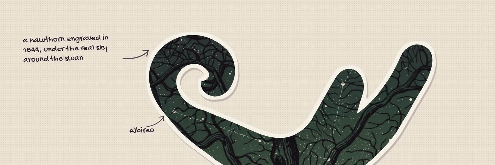

I’m **yarmuts**, an internet enthusiast. Linux, code, the wwweb, the old internet and making websites by hand. I write words, I’m learning to write code, and I have opinions about most of it.

My den is **[yarmuts.website](https://yarmuts.website/)**, a room on the internet with things pinned to its walls. It’s written by hand, in HTML and CSS, and [its source lives here](https://github.com/yarmuts/website).

- **Elsewhere:** [Mastodon](https://infosec.exchange/@yarmuts) · [Bluesky](https://bsky.app/profile/yarmuts.website) · [Lemmy](https://programming.dev/u/yarmuts) · [Pixelfed](https://pixelfed.com/yarmuts) · [Telegram](https://t.me/yarmuts)
- **Write to me:** yarmuts@tuta.io
- **My commits are signed** with this OpenPGP key: `8538 039F 5F26 179B 8893 0C53 FE25 FE65 0658 A54D` ([yarmuts.asc](https://yarmuts.website/yarmuts.asc))

